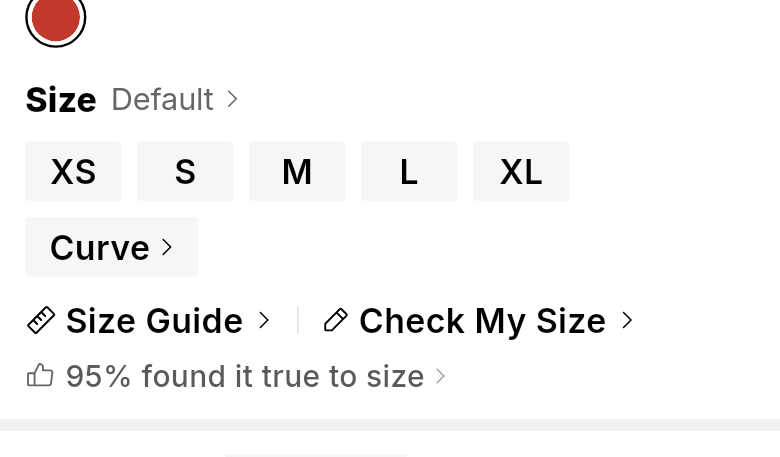
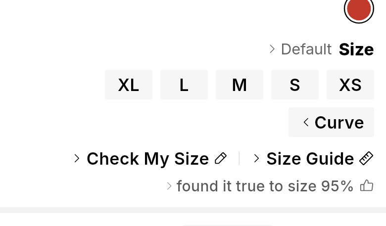
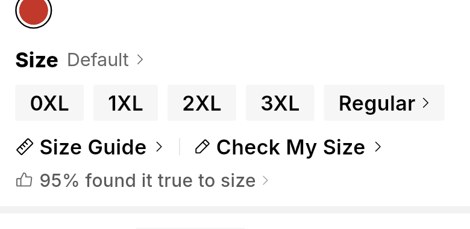
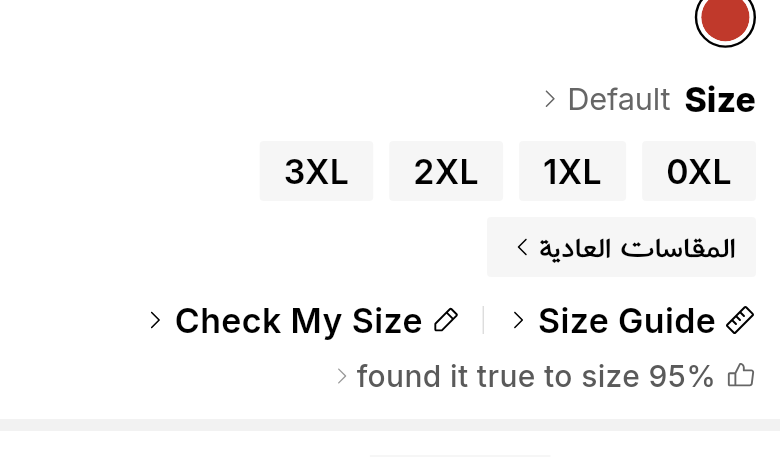
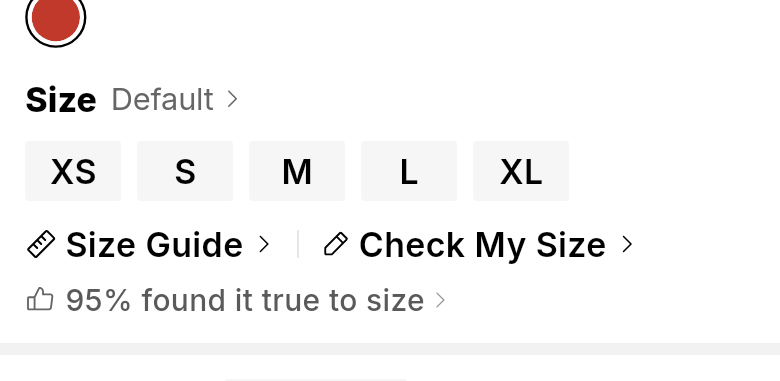
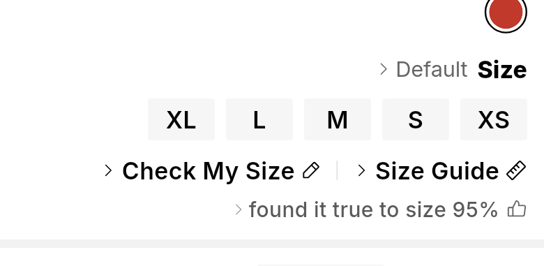

# T100 — size_twin réel (W4)

carvo-design branche `g2/t100-size-twin-api`, commit `fe97e79b8d54128b722a357503179d6d6e2d809b`.
Rendu par `test/t100_size_twin_api_test.dart` (390×844, ×2) à partir de JSON parsé par `Product.fromJson`, forme du contrat carvo-sourcing #715.
LTR en anglais ; RTL dans la langue arabe de l'app (`label_ar`).

| | LTR | RTL |
|---|---|---|
| fiche normale, `kind: curve` |  |  |
| fiche Curve, `kind: regular` |  |  |
| `size_twin: null` |  |  |
