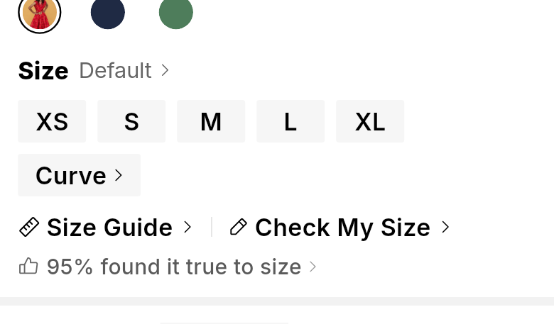
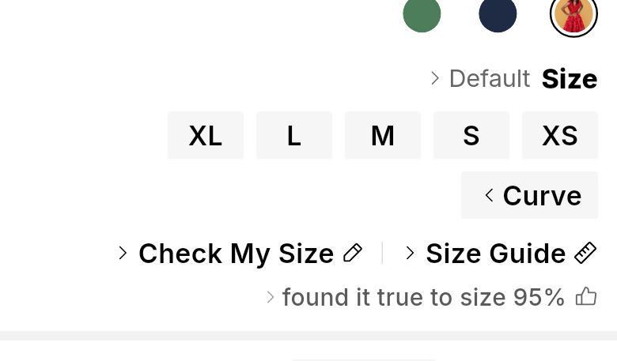
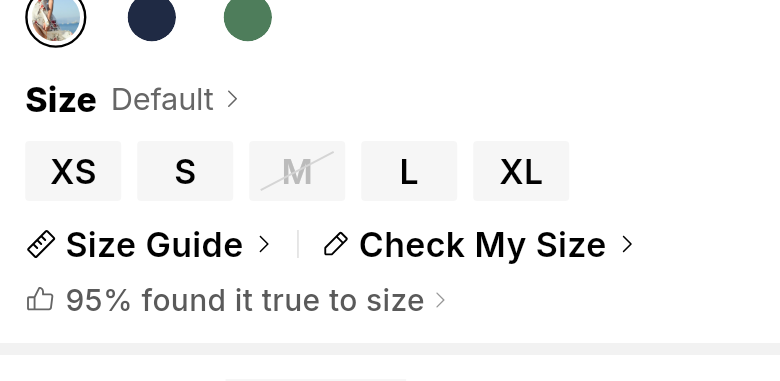

# T95 — puce « Curve › » (W3)

carvo-design PR base `step-7d-split-data-flags`, branche `g2/t95-curve-chip`, commit `86aa437226da05f16e18e66783dcf87eec6d9f3c`.
Rendu par `test/t95_size_twin_test.dart` (390×844, ×2). Fixture de démonstration : produit 9 ↔ 18 (pas de vraie donnée T94).

| | LTR | RTL |
|---|---|---|
| avec jumeau (9) |  |  |
| sans jumeau (1) |  |  |
